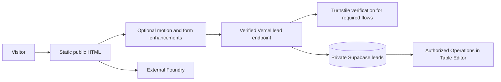

# Bug Refinery architecture review

This records the original audit recommendation. The owner later approved the screenshot stack for the public website. See [the stack decision](STACK_DECISION.md).

The checkout is a static replica. The BRD/FRD describe a public acquisition system with a narrowly scoped backend. The Industry Simulation Platform document is a draft for a separate authenticated delivery product and explicitly disclaims knowledge of Bug Refinery's private implementation. The screenshot is a suggested stack, not evidence of a deployed integration. Keep these boundaries in code, identity, data and releases.

## Layer comparison

| Layer | Checked-out BugR | Stack screenshot | Blueprint §11 and recommendation |
|---|---|---|---|
| Frontend | HTML/vanilla JS | React + TypeScript | Next.js/React/TS suggested. Keep static HTML in public production under current BRD; choose React/TS for the platform if approved, with Next.js only if its routing/rendering needs justify it. |
| Styling | Tailwind CDN, repeated inline config, CSS | Tailwind CSS | Same suggestion; platform can compile it. Consolidate essential public CSS locally under the no-build constraint. |
| Backend | None | Node.js/Express | Express or NestJS proposed. Public system needs its existing Vercel lead function; Express modular monolith is a separate platform candidate. |
| Database | None | Supabase | Blueprint says PostgreSQL. Supabase-hosted PostgreSQL is a candidate for the platform in a separate project from private website leads. |
| ORM | None | Optional Prisma | Blueprint suggests Prisma. Decide one migration authority; adopt Prisma only if team benefits and preserves policy/transaction ownership. |
| Auth | None | Supabase Auth and secure sessions | Blueprint suggests JWT/refresh handling or approved identity provider. Platform can use Supabase Auth, server-verified sessions and resource-level authorization; no public accounts. |
| File storage | None | Supabase Storage/S3-compatible | Blueprint suggests S3-compatible. Choose private platform buckets, short-lived signed URLs and validated uploads; no site file uploads. |
| Background jobs | None | Edge Functions and scheduled jobs | Blueprint suggests Redis/BullMQ. Scheduler/Edge Functions can trigger light work; choose durable jobs with retries, deadlines and worker isolation for execution. Neither is present. |
| Code execution | Fake terminal text only | Docker-based isolated sandbox | Blueprint agrees. Docker is a packaging baseline; review isolation against untrusted workloads before pilot. Never execute from the website. |
| Deployment | No checked-in deployment/CI | Docker, cloud, CI/CD | Blueprint agrees for platform. Preserve documented GitHub/Vercel public workflow once verified; give platform separate pipelines and credentials. |
| Testing | None checked in | Jest/Vitest, Playwright | Blueprint agrees. Test platform authorization and workflow end to end; public checks can run separately from the no-build runtime. |
| Monitoring | None checked in | Central logs, metrics, errors | Blueprint agrees. Use sanitized service diagnostics and availability checks; public browser analytics are excluded by default. |

## Conflicts and decisions

| Topic | Public baseline vs other input | Proposed resolution |
|---|---|---|
| 3D and brand | User wants a moving 3D site; BRD §4 excludes heavy 3D/WebGL and notes a prior demo wasn't approved for live. BR-02 and FN-G-07 reject substituting a 3D/sans theme; NF-01–05 require small static pages, low-end phones and fallbacks. | Demo with original geometry and optional WebGL; baseline live proposal uses brand tokens and lightweight motion. Approve demo and separately record an amendment/release decision before shipping out-of-baseline visuals or framework. |
| Sign Up | Lead-only, anonymous interest vs student registration, authentication, profile and enrollment. | Separate “Sign Up” interest from platform “Sign In/Enroll.” No automatic lead-to-account conversion. |
| Lab scope and launch | 26 public listings, all STARTING SOON; first founder cohort Python Full Stack only. Draft pilots are Data Analytics and Cyber Security; all 26 fully authored not MVP. | Public listing is an offer; two private technical pilots validate engine feasibility. Pilots do not change public lab statuses or founder batch. |
| Data and payments | Lead/contact data only; no checkout, dashboard or alerts. Blueprint includes roles, uploads, submissions, progress, payments if approved, notifications and admin analytics. | Separate database/credentials, access and retention. Payment is a later explicit decision, never part of this site plan. |
| Companies | Anonymous inquiry vs later verified recruiter search, portfolios and shortlist. | Keep inquiry; no employer dashboard or automatic sharing. Require verification, approved visibility and consent on platform. |
| Foundry | Separate external site and future wing vs active local services replica. | Replace public nav destination during approved change; exclude local Foundry pages/services from feature scope; agree redirect or retirement. |
| FRD ambiguities | BRD LD-02 reads as phone required generally; FRD §8/Appendix A specifically require it on main forms, while UC-01 describes phone for lab modals. Sign Up is separate from the three Turnstile main forms; exact Sign Up attribution (“source page”) can mean entry route vs form surface. | Confirm phone rules on Sign Up/labs, distinguish flow source from optional referrer if approved, and confirm Turnstile requirements and server enforcement against the actual contract. |
| Lead retries and messaging | FRD requires at most one row even across refresh, in-flight disabling alone cannot guarantee this, and a lost response cannot prove no insert. ERR-04 calls for reverification while TC-12 says not to expose failed controls. | Confirm existing idempotency and token contract; design duplicate-safe retry and honest “couldn't confirm” outcome. Agree public generic rejection vs actionable reverification without internal detail. |

Also verify whether strict source validation and server-derived trusted flow context prevent a main-form caller from spoofing a no-Turnstile lab source. If production contract permits bypass, agree mitigation with owner; don't silently widen bot-verification scope.

## Public target



Keep HTML pages and original production paths discoverable. No canvas-only content or mandatory client router. Implement one reviewed server contract for the 30 surfaces. Keep validation → honeypot → rate limit → Turnstile where required → insert → confirm order. Enforce name/email/phone per approved rules, length limits, JSON schema and allowlisted source; verify five per IP per hour through a shared atomic hashed-IP counter across instances, trusted proxy address extraction, short retention and no raw IP persistence. Use server-only environment secrets and private RLS with no public policies; no duplicate email/browser/third-party lead storage. Rate-limit counts, expiry, idempotency contract, actual schema, response and keep-alive job (48-hour ops check) need verification. Use no PII in logs; render honest unavailable states. Keep outbound Foundry and support available independently of lead infrastructure.

Proposed layout is logical; names for new files are examples. Confirm the authoritative paths before adding or relocating anything.

```text
website repository
  index.html about.html companies.html contact.html labs.html signup.html students.html
  labs/                         26 static pages; retain verified production filenames
  assets/
    css/                        retain existing production main/lab shared files
    js/                         retain shared entrypoints; isolate optional enhancements
    images/                     approved logo, icons, static hero fallback
    motion/                     reviewed local CSS/SVG or optional prototype assets
  reference/
    catalogue.json              approved names, slugs, areas, terms, curriculum references
    patterns.md                 shell, page sections, field and modal markup contracts
  api/                          existing deployed lead route, if recovered here
  sitemap.xml robots.txt
  tests/                        route, content and lead contract checks; no production build dependency
```

Use HTML patterns for `SiteHeader`, `MobileNav`, `SiteFooter`, `CookieChoice`, `PageHero`, `SectionHeading`, `AreaCard`, `LabCard`, `CurriculumPhases`, `TermsStrip`, `LeadFields`, `LeadStatus`, `LabSignupDialog` and `TerminalExample`. Keep essential markup in the served documents; validate duplicated shell/catalogue against reference data. A maintainer tool can emit committed HTML if approved; no required production build. Preserve actual shared lab asset names; this checkout cannot identify them. Make rendering architecture and URL changes separate decisions from adding motion.

## Separate platform target, if commissioned

```text
platform repository
  apps/portal/                  student, mentor, admin; recruiter routes later
  apps/api/                     Node/Express modular REST API
    modules/                    identity, users, catalogue, enrollment, learning,
                                simulation, tasks, submissions, assessment,
                                mentors, portfolio, reporting
  workers/validation/           queued artifact checks, results, retries
  runner/                       isolated disposable workloads; no production credentials
  packages/contracts/           typed API schemas and status transitions
  packages/ui/                  portal components and optional approved brand tokens
  infra/                        schema migrations, storage policies, queue and observability
  tests/                        permissions, lifecycle, uploads and runner containment
```

Use one configurable engine. A lab supplies a scenario, artifact type, task, allowed evidence, validation policy and versioned rubric. An attempt becomes a submission; validation gates review; mentor can request changes or approve; approval updates progress; approved work can later qualify for portfolio/certificate. Backend enforces role plus ownership/cohort/assignment on every protected action. Store artifacts privately, validate uploads, use synthetic/anonymized Medical data, audit changes, test backups and retention. Runner obtains only scoped job inputs; enforce disposable isolation, CPU/memory/time quotas, restricted network, no metadata/database access, and no secrets; return bounded results via controlled channel. Verify containment and negative permission tests before either pilot runs real user code.

Keep website and platform operationally separate. An approved, versioned public catalogue export or design tokens can be shared later; no runtime dependency from marketing HTML to platform, no implicit lead transfer, and no pressure to launch both together.
